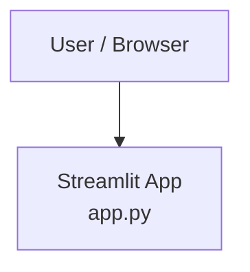

# Architecture — Streamlit Greeter

## System Context

## Containers
- **Streamlit App (`app.py`)** — Python process serving the Streamlit web UI. Single file, no separate backend. Runs on the default Streamlit port (8501). No external datastores or APIs.

## Boundary Rules
- All user interaction happens through the Streamlit UI layer (`app.py`) — no separate backend API
- No I/O to external services, databases, or filesystems at runtime
- All application logic lives in `app.py`; no sub-modules until the app grows beyond a single behaviour

## Governing ADRs
- [ADR-0001 — Record architecture decisions](../adr/0001-record-architecture-decisions.md)
